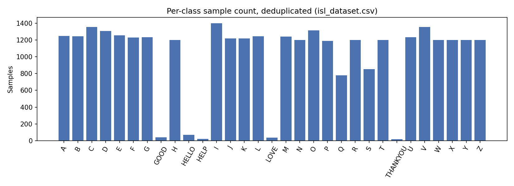
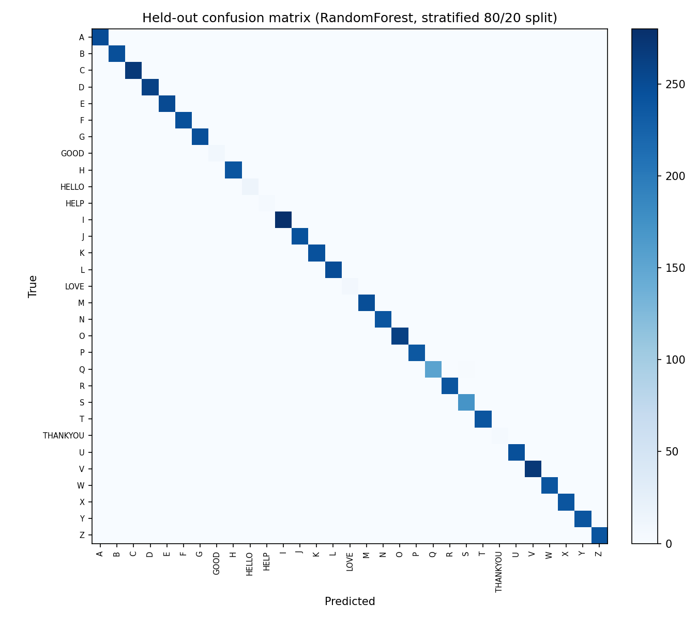

# Evaluation Results (real, reproducible via `python evaluate.py`)
Environment: Python 3.14.0, Windows-11-10.0.26200-SP0, Intel64 Family 6 Model 170 Stepping 4, GenuineIntel, scikit-learn 1.8.0, numpy 2.4.2, scipy 1.17.1.
## 1. Dataset
- Raw: 31806 samples, 31/35 target classes populated (missing: NO, PLEASE, SORRY, YES -- unrecorded, out of scope for this study, documented as future work).
- After removing 118 exact-duplicate feature rows ({'webcam': 117, 'kaggle': 1}): **31688 usable samples, 31 classes** -- this is the dataset used for every experiment below.
- Domain split: {'webcam': 816, 'kaggle': 30872}.
- signer_id/session_id values: ['kaggle_unknown', 'unassigned_signer', 'unknown_legacy'] / ['kaggle_import', 'unassigned_session', 'unknown_legacy']. These are placeholder source tags (unknown_legacy / kaggle_unknown / unassigned_signer / kaggle_import / unassigned_session), not real signer or session identities. No signer-independent or session-independent claim is made anywhere in this evaluation.

## 1b. Near-duplication (intra- vs cross-burst distance, post-dedup)
- Classes with >=2 independent recording bursts: 29.
- Intra-burst consecutive-frame L2 distance: mean 0.3466 (n=764 pairs).
- Cross-burst same-label L2 distance: mean 2.5514 (n=8238 pairs), ratio (cross/intra) 7.36x.
> burst_id is near-unique per row for the Kaggle-sourced majority of the data (mean group size ~1.03); this diagnostic is only informative for the small legacy-webcam subset that actually has multi-row bursts.
## 2. Leakage demonstration: burst_id as a split control
- Naive random 80/20 split: **99.91%** accuracy, macro-F1 0.999.
- Burst-disjoint split (29 classes with >=2 bursts): **97.24%** accuracy, macro-F1 0.895.
> Unlike the pre-Kaggle-merge dataset (where burst-disjoint splitting collapsed accuracy to 0% because almost every class had exactly one burst), burst-disjoint and naive-random splits now give SIMILAR results. This is not because leakage was fixed -- it's because burst_id is near-unique per row for 97% of the current data (Kaggle-sourced), so grouping by burst barely constrains the split at all. burst_id is not a meaningful leakage control at the current dataset composition.
## 3. Repeated-split statistics (10 seeds)
- Naive split accuracy: 99.81% +/- 0.08pp, bootstrap 95% CI [99.77%, 99.86%] (macro-F1 0.996 +/- 0.002).
> The 10 seeds are overlapping 80/20 resamples of the same 31688 deduplicated rows, not 10 independent datasets -- this measures sensitivity to split randomness, not true sampling variability.
## 4. Cross-source (domain) evaluation -- KEY FINDING
Shared classes (present in both Kaggle and Webcam sources): A, B, C, D, E, F, G, I, J, K, L, M, U, V (14 classes). Domain sizes: {'webcam': 816, 'kaggle': 30872}.

| Setting | n_train | n_test | Accuracy [95% CI] | Macro-F1 [95% CI] |
|---|---|---|---|---|
| In-domain: train+test Kaggle | 11998 | 5143 | 99.9% [99.8, 100.0] | 0.999 [0.998, 1.000] |
| In-domain: train+test Webcam | 407 | 224 | 46.9% [40.6, 53.6] | 0.210 [0.189, 0.242] |
| Cross-domain: train Kaggle -> test Webcam | 17141 | 631 | 50.4% [46.6, 54.0] | 0.312 [0.296, 0.325] |
| Cross-domain: train Webcam -> test Kaggle | 631 | 17141 | 29.4% [28.7, 30.1] | 0.211 [0.208, 0.214] |

> in_domain_* results show what accuracy this feature representation/classifier achieves when train and test come from the same source. kaggle_to_webcam and webcam_to_kaggle show what happens when the model has never seen the OTHER source at all. A large drop from in-domain to cross-domain accuracy is evidence of genuine domain shift (capture device / lighting / temporal smoothing / detection-threshold differences), not of the model failing to learn the sign shapes themselves. 95% CIs are bootstrapped over the fixed test-set predictions (2000 resamples) -- they quantify test-set sampling uncertainty for a single trained model, not retraining variability; the smallest cross-domain test sets (e.g. n_test=631 for kaggle_to_webcam) have correspondingly wide CIs, shown explicitly rather than implied by a bare point estimate.
## 5. Handedness analysis (held-out)
Distribution: {np.str_('both'): 16301, np.str_('right_only'): 9699, np.str_('left_only'): 5688}.

| Test subset (by detected handedness) | n_test | Accuracy | Macro-F1 |
|---|---|---|---|
| both | 3261 | 100.0% | 1.000 |
| right_only | 1937 | 99.9% | 0.998 |
| left_only | 1140 | 99.6% | 0.977 |

> Handedness here is inferred from which hand-feature block is non-zero at capture time, not ground-truth sign linguistics (some classes are inherently one-handed signs; this mixes 'sign is one-handed' with 'only one hand was detected'). A single classifier trained on the full mixed-handedness training set is evaluated separately on each test subset, so this measures whether ONE model generalizes evenly across handedness conditions, not whether per-handedness specialist models would do better.
## 6. Held-out classifier comparison
| Classifier | n_train | Held-out acc | Macro-F1 | Train time (s) | Predict latency (ms/sample) |
|---|---|---|---|---|---|
| RandomForest(100,d15) | 25350 | 99.9% | 0.999 | 3.485 | 52.89 |
| SVM-RBF(C=10) | 5999 | 99.6% | 0.965 | 0.182 | 0.25 |
| kNN(k=5) | 25350 | 99.9% | 0.991 | 0.036 | 3.35 |
| MLP(128,64) | 25350 | 100.0% | 1.000 | 25.230 | 0.20 |

> Held-out stratified 80/20 split (post-dedup). SVM-RBF trained on a stratified subsample capped at 6000 rows for tractability (RandomForest/kNN use the full 25350-row training set); this may understate SVM's achievable accuracy but doesn't invalidate the comparison's direction. Latency is single-sample CPU inference on the development machine, excludes MediaPipe detection time.
## 7. Confusion matrix + per-class error analysis (held-out)

Top held-out confusions (true, pred, count): [('Q', 'S', 2), ('B', 'O', 1), ('C', 'S', 1), ('O', 'S', 1), ('U', 'S', 1)]
## 8. Feature ablation (held-out)
| Feature set | # features | Held-out acc | Macro-F1 |
|---|---|---|---|
| full_132 | 132 | 99.9% | 0.999 |
| no_relative_126 | 126 | 99.9% | 0.999 |
| right_hand_only_63 | 63 | 85.9% | 0.830 |

> Held-out stratified 80/20 split, same split as section 6/7.
